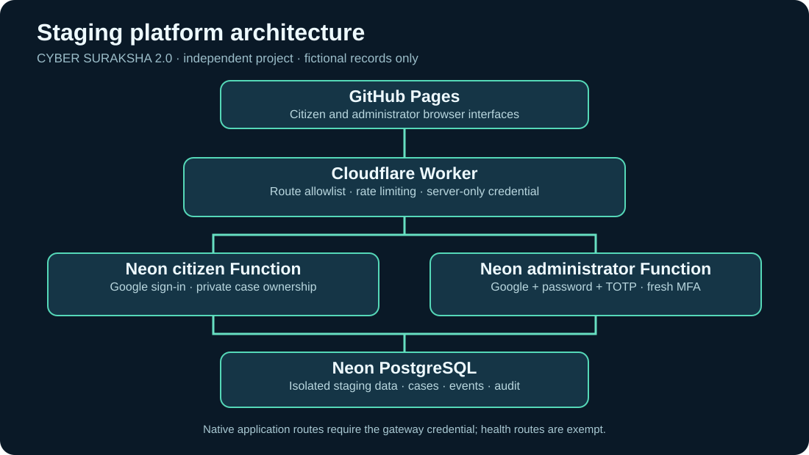

# Deployment and operating environments

[Repository](README.md) · [Architecture](docs/ARCHITECTURE.md) · [Release checklist](docs/RELEASE_READINESS.md)

The repository holds **separate services**. This guide replaces older instructions that treated the original Flask training application as the current hosted awareness website.

## Public multilingual awareness website

| Setting | Source |
| --- | --- |
| Application | [FastAPI entrypoint](deploy/cyber-suraksha-independent/main.py) |
| Dependency file | [requirements.txt](deploy/cyber-suraksha-independent/requirements.txt) |
| Blueprint | [render.yaml](render.yaml) |
| Health check | `/api/v1/health` |
| Build | `pip install -r deploy/cyber-suraksha-independent/requirements.txt` |
| Start | `cd deploy/cyber-suraksha-independent && uvicorn main:app --host 0.0.0.0 --port $PORT --no-access-log` |

The root Blueprint has auto-deploy disabled in source configuration. Actual Render settings, service health, price and latest deployed SHA must be verified on the hosting account. This service provides educational content only and does not permit official complaints or real case intake.

[Detailed migration and deployment notes](docs/REBUILD_DEPLOYMENT.md) · [Public privacy notice](deploy/cyber-suraksha-independent/PRIVACY.md)

## Separate owner-only pilot

| Setting | Pilot source configuration |
| --- | --- |
| Application | [Flask portal](deploy/citizen-owner-portal/) |
| Blueprint | [render-free-pilot.yaml](deploy/citizen-owner-portal/render-free-pilot.yaml) |
| Private mode | `PRIVATE_MODE=1` |
| Public registration | `PUBLIC_REGISTRATION=0` |
| Admin entry | `/en/admin/login`, with protected `/en/admin` |
| Database | Independently provisioned persistent PostgreSQL |
| Mail | Privately configured sender and provider |
| Session and MFA | Unique protected secrets, owner verification and recent authenticator MFA |

The owner pilot's operational secrets and actual configuration cannot be inferred from a repository manifest. Verify them privately on the relevant service before declaring owner-only enforcement. Never move the public site to the owner portal root or alter its access controls without a separate reviewed change.

[Owner pilot guide](deploy/citizen-owner-portal/README_FREE_OWNER_PILOT.md) · [Access review](docs/OWNER_PORTAL_ACCESS_REVIEW.md)

## Historical local Flask training app

The earlier [app.py](app.py) and [run_windows.bat](run_windows.bat) are preserved for local synthetic training. Prior `/health`, `PUBLIC_DEMO_MODE`, and SQLite guidance refer to that older application, **not** the current FastAPI Render Blueprint.

## Verification and rollback

Record Git SHA, linked branch, service name, observed deployment time and sanitized checks. Test permitted routes, denied routes, HTTPS and headers, backup recovery and dependency health before a release. Do not place secrets in logs or issues. Preserve a known-good deployed revision and never merge public-registration changes accidentally.

No third-party company, government department or law-enforcement agency approves or operates this software.
