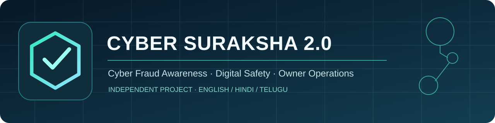

# CYBER SURAKSHA 2.0 — Project documentation

**Project:** From Cyber Fraud Awareness to Intelligent Cybercrime Prevention & Response  
**Project scope:** Independently maintained educational awareness, private owner pilot and preserved training applications.

[Documentation center](docs/README.md) · [Project overview](docs/PROJECT_OVERVIEW.md) · [Technology stack](docs/TECHNOLOGY_STACK.md)

## Objective

Provide understandable digital-safety information in English, Hindi and Telugu, explain common scam signals and response actions, and demonstrate responsible defensive-security workflows using synthetic training data.

## Current source components

| Service | Purpose | Source | Public status |
| --- | --- | --- | --- |
| Multilingual awareness | Safety guidance, on-device tools, quiz and agency references | [FastAPI website](deploy/cyber-suraksha-independent/) | Public educational design |
| Owner-only pilot | Owner identity, email verification, MFA and controlled workflows | [Flask portal](deploy/citizen-owner-portal/) | Configured private mode, live verification required |
| Historic Flask training | Fictional reporting, SOC triage, Zero Trust and disclosure exercises | [Original app](app.py) | Local training reference |
| Earlier integrated UI | Previous prototype and evaluation exercises | [Earlier website](upgrades/unified-website/) | Historical source |

## Technology

**Python · Flask · FastAPI · HTML · CSS · JavaScript · SQLite · PostgreSQL · SQLAlchemy · Git · GitHub · Render · PowerShell.** Components vary; review the [file-level language map](docs/TECHNOLOGY_STACK.md) for exact usage.

## Historical training modules

The original local Flask/SQLite application includes:

1. Fictional incident reporting and reference tracking.
2. Incident register, detail views and simulated status transitions.
3. Financial-fraud decision exercises.
4. Synthetic SOC alert triage and investigation notes.
5. Simulated Zero Trust access decisions.
6. Responsible disclosure exercises for fictional assets.
7. Multilingual awareness and knowledge quizzes.
8. Local testing and development-stage integration.

These are educational simulations; they do not connect to banks, government complaint systems, SIEM platforms or real law enforcement.

## Local test and operating guides

- [Awareness website](START_R4_WINDOWS.bat) — designed for `127.0.0.1:8094`.
- [Original Flask training app](run_windows.bat) — historical local launcher (often `127.0.0.1:5000`).
- [Private owner pilot](deploy/citizen-owner-portal/README_FREE_OWNER_PILOT.md) — separately configured application requiring protected secrets and a database.
- [Testing policy](docs/TESTING.md), [manual acceptance list](MANUAL_TEST_CHECKLIST.md), [release readiness](docs/RELEASE_READINESS.md).

## Restrictions

Use synthetic training material only. The public awareness site does not create official police complaints, and the private pilot must not take real sensitive reports without appropriate release checks. Never publish credentials, live cases, personal records or private databases. No government, police, bank or institutional affiliation is claimed.

## Identity, copyright and licensing

The repository is independently managed. Preserve third-party licenses and provide truthful evidence for claimed authorship. See [LICENSE](LICENSE), [copyright registration preparation](docs/COPYRIGHT_REGISTRATION_PREPARATION.md), and [media credits](docs/VISUAL_ASSETS.md).
