# CYBER SURAKSHA 2.0

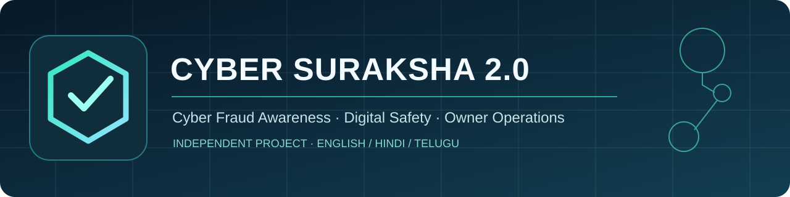

## From Cyber Fraud Awareness to Intelligent Cybercrime Prevention & Response

An independently operated cybersecurity awareness, education and fictional incident-response platform. Owned by Jatoth Ramakrishna. No institutional partnership, government endorsement or external funding is claimed.

[Public website](https://rk-hud.github.io/cyber-suraksha-2.0/) · [Staging citizen workspace](https://rk-hud.github.io/cyber-suraksha-2.0/google-test/en/account.html) · [Staging administrator workspace](https://rk-hud.github.io/cyber-suraksha-2.0/google-test/en/operator.html) · [v2.2.0-staging release](https://github.com/rk-Hud/cyber-suraksha-2.0/releases/tag/v2.2.0-staging) · [Deployment record](docs/STAGING_RELEASE_20261122.md)

  

> Independent project, not a government or police reporting service. Staging accepts fictional records only. For real cybercrime in India, use [cybercrime.gov.in](https://cybercrime.gov.in/) or call **1930**; contact your bank promptly for financial fraud.

## Platform capabilities

| Citizen services | Secure administrator workspace |
| --- | --- |
| Google sign-in in restricted staging | Separate verified Google identity, password and TOTP |
| Fictional complaint registration and tracking | Searchable case directory and complete complaint history |
| Private case timeline and replies | Registered users, authentication activity and sessions |
| Fraud-awareness checker and action planner | Case status updates and audit history |
| English, Hindi and Telugu content | Fresh MFA and separate authorization |

## Architecture

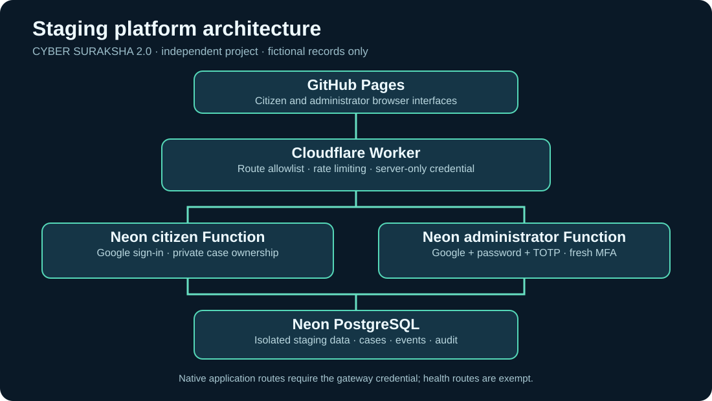

The staging browser communicates with a Cloudflare Worker, which forwards permitted routes to separate Neon citizen and owner Functions. A private server-side credential protects origin application routes; user authentication and authorization remain separate. Health routes are intentionally accessible. Native Neon invocation URLs remain reachable at the network layer.

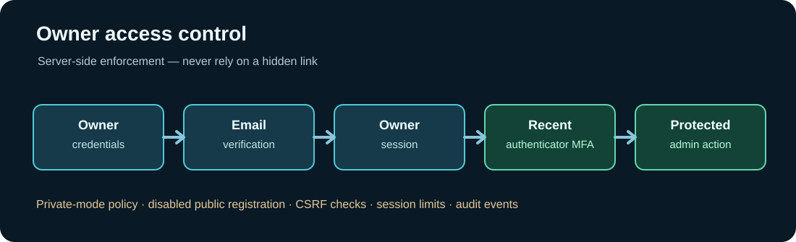

## Website and demonstration

| Environment | Link | Scope |
| --- | --- | --- |
| Public awareness website | [Open website](https://rk-hud.github.io/cyber-suraksha-2.0/) | Public educational content |
| Citizen staging | [Citizen services](https://rk-hud.github.io/cyber-suraksha-2.0/google-test/en/account.html) | Restricted Google sign-in; fictional cases |
| Owner staging | [Administrator workspace](https://rk-hud.github.io/cyber-suraksha-2.0/google-test/en/operator.html) | Authorized owner only |

The illustrations above are explanatory graphics, not screenshots. Authenticated screenshots should be cropped and redacted before publication.

## Live website gallery

Actual deployed website screenshots captured on 22 November 2026, cropped and sharpened for readability. Select an image to open its corresponding website section.

### Home

Platform introduction and digital safety tools.

[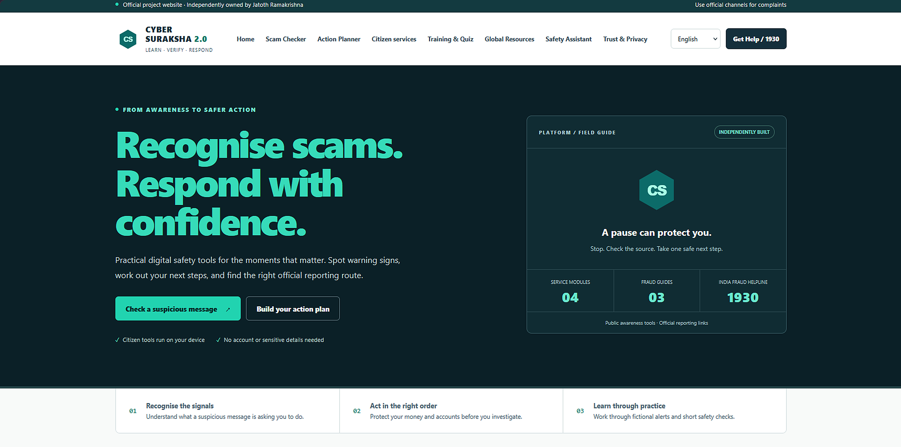](https://rk-hud.github.io/cyber-suraksha-2.0/google-test/en/)

### Scam Checker

Explainable browser-based warning-sign checks.

[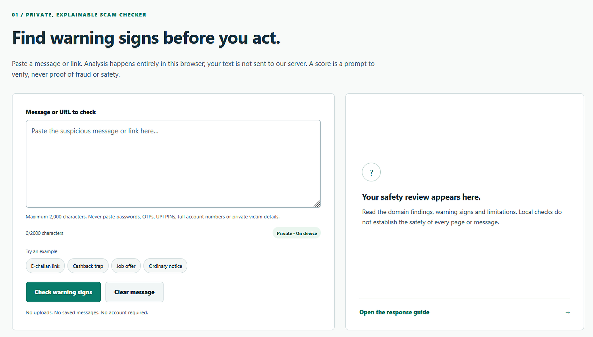](https://rk-hud.github.io/cyber-suraksha-2.0/google-test/en/#checker)

### Action Planner

Ordered protective steps and reporting guidance.

[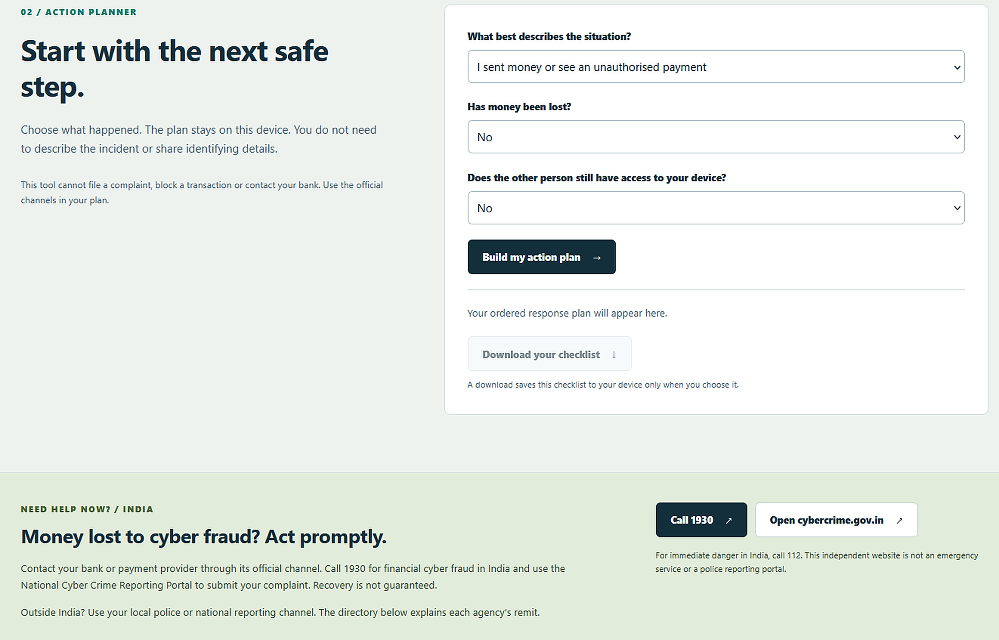](https://rk-hud.github.io/cyber-suraksha-2.0/google-test/en/#planner)

### Citizen Services

Separate citizen sign-in and administrator access in restricted staging.

[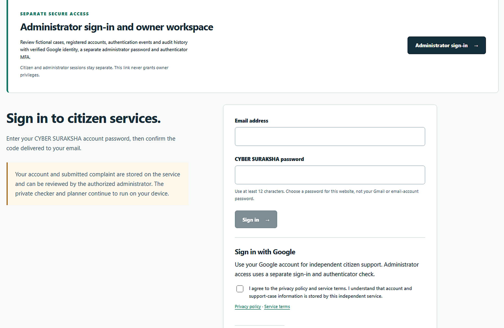](https://rk-hud.github.io/cyber-suraksha-2.0/google-test/en/account.html)

### Training & Quiz

Practical cybersecurity awareness exercises.

[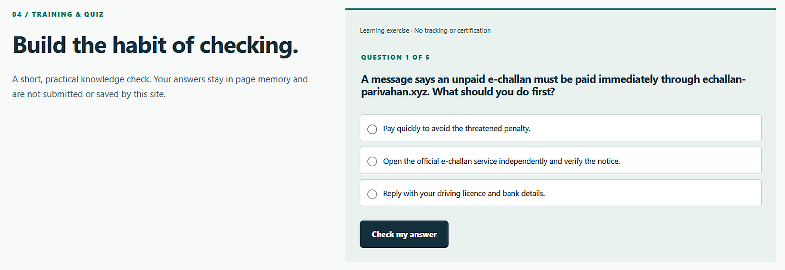](https://rk-hud.github.io/cyber-suraksha-2.0/google-test/en/#training)

### Global Resources

Official resource directory entry (collapsed in this capture).

[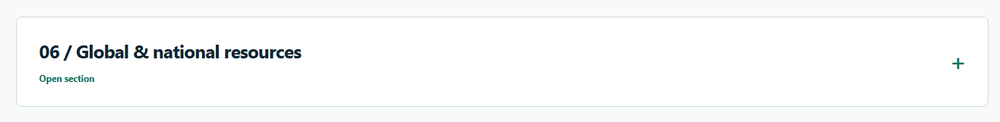](https://rk-hud.github.io/cyber-suraksha-2.0/google-test/en/#resources)

### Safety Assistant

Local, rule-based digital safety guidance.

[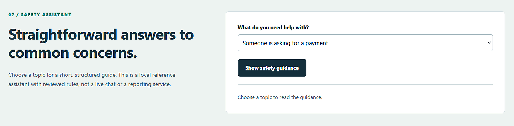](https://rk-hud.github.io/cyber-suraksha-2.0/google-test/en/#assistant)

### Trust & Privacy

Data-handling boundaries and limitations.

[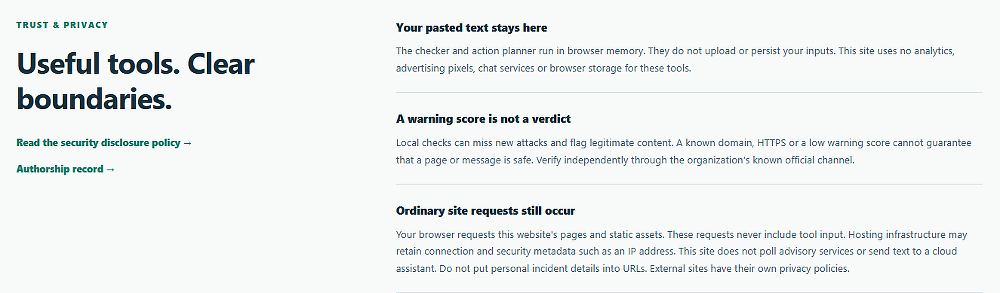](https://rk-hud.github.io/cyber-suraksha-2.0/google-test/en/#privacy)

## Source map

| Component | Source |
| --- | --- |
| Multilingual interface | [web/pages](web/pages/) |
| Citizen and owner APIs | [services/account-api](services/account-api/) |
| Edge gateway | [Worker source](services/account-api/gateway/worker.mjs) |
| Database schema | [SQL](services/account-api/sql/) |
| Deployment evidence | [Staging release record](docs/STAGING_RELEASE_20261122.md) |
| Earlier applications | [deploy](deploy/), [upgrades](upgrades/), [app.py](app.py) |

## Verification and development

Run `npm ci`, `npm run check`, `npm test` and `npm run build` in `services/account-api`. Database tests require a disposable PostgreSQL database. Inside `web/pages`, install Python dependencies from `requirements-build.txt`, run `npm ci`, `npm test`, `npm run build` and `npm run verify`. Staging build configuration is `config/google-test.json`. Never publish credentials or case exports.

See [CI](.github/workflows/account-services.yml), [security policy](SECURITY.md), [API contract](services/account-api/API.md), [deployment guidance](DEPLOYMENT.md) and [release acceptance](https://github.com/rk-Hud/cyber-suraksha-2.0/issues/9).

## Release boundaries

Staging login, dashboard and complaint detail display were demonstrated on 22 November 2026. Direct-origin rejection and gateway authentication were tested. A successful isolated backup restoration, independent security assessment and production authorization remain outstanding. Email delivery is not claimed. The warning-sign checker provides educational guidance, not a fraud probability or guarantee.

Copyright © 2026 Jatoth Ramakrishna. Software reuse is governed by the [MIT License](LICENSE); third-party materials retain their respective licenses. See [copyright preparation](docs/COPYRIGHT_REGISTRATION_PREPARATION.md).
