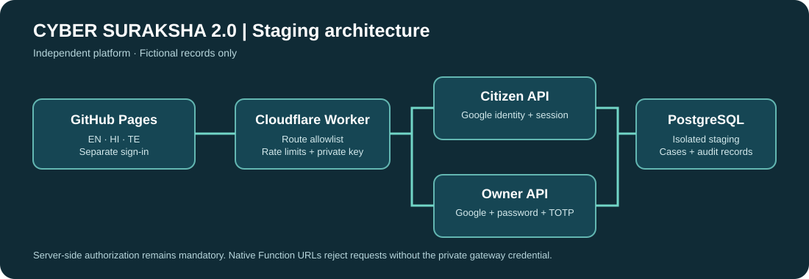

# CYBER SURAKSHA 2.0
### From Cyber Fraud Awareness to Intelligent Cybercrime Prevention & Response

Independent cybersecurity awareness, training and private support platform. Project owner: **Jatoth Ramakrishna**. No institutional affiliation, government endorsement or external funding is claimed.

**[Public website](https://rk-hud.github.io/cyber-suraksha-2.0/) · [Staging citizen services](https://rk-hud.github.io/cyber-suraksha-2.0/google-test/en/account.html) · [Staging administrator workspace](https://rk-hud.github.io/cyber-suraksha-2.0/google-test/en/operator.html) · [Release evidence](docs/STAGING_RELEASE_2026-11-22.md) · [Security policy](SECURITY.md)**

> **Staging demonstration:** fictional records only. This is not a government or police reporting portal. Never submit real victim or financial information. In India, contact your bank immediately for financial fraud, call **1930**, and use [cybercrime.gov.in](https://cybercrime.gov.in/).

## Platform capabilities

| Public awareness | Citizen workspace | Restricted owner workspace |
| --- | --- | --- |
| Scam warning signs and checker | Google sign-in in staging | Separate Google, password and TOTP |
| Action planner and quiz | Fictional complaint submission | Citizen directory and case search |
| English, Hindi and Telugu | Private status tracking and replies | Original complaint and activity history |
| Official resource references | Session-based access | Status updates, sessions and audit history |

## Architecture

GitHub Pages serves the static multilingual website. The staging Cloudflare Worker routes allowlisted requests to separate Neon Functions (Node.js 24), with private upstream credentials and rate limiting. PostgreSQL stores staging records. Existing owner access remains separate from citizen sessions.

## Delivery status

| Area | Status |
| --- | --- |
| Unified staging website and both APIs | Deployed; owner-reported functional evidence |
| Gateway credential enforcement | Tested for unauthenticated and direct-origin requests |
| Backup and isolated restore | Open — restore not verified |
| Production readiness | Not approved; additional privacy/security acceptance required |

[Staging evidence and limitations](docs/STAGING_RELEASE_2026-11-22.md) · [Acceptance tracker](https://github.com/rk-Hud/cyber-suraksha-2.0/issues/9) · [Recovery review](https://github.com/rk-Hud/cyber-suraksha-2.0/pull/11)

## Source map

| Component | Source | Hosting |
| --- | --- | --- |
| Multilingual website and account interface | [web/pages](web/pages/) | GitHub Pages |
| Authentication, private cases and owner authorization | [services/account-api](services/account-api/) | Neon Function, Node.js 24 |
| Accounts, case history, notifications and audit records | [Schema](services/account-api/sql/001-existing-portal.sql) | Neon PostgreSQL |
| Previous owner portal | [deploy/citizen-owner-portal](deploy/citizen-owner-portal/) | Existing Render service, retained during migration |
| Earlier applications | [deploy](deploy/), [upgrades](upgrades/), [app.py](app.py) | Historical reference; deployment-specific instructions apply |

## Accounts and administration

The account service implements password plus email OTP, password recovery, private complaint submission, case timelines and replies. The owner dashboard requires the configured owner identity and a recent authenticator code before viewing user records, changing cases or editing content. Passwords, OTPs and signing keys are never shown in the dashboard.

Deployment and activation are separate: **public registration stays closed while email sending is unconfigured**. The [status record](docs/ACCOUNT_SERVICE_STATUS.md) states what is deployed and what needs private configuration. No email is presented as sent when a provider rejected it. Existing owner MFA is preserved during migration.

See the [operator guide](docs/ACCOUNT_SERVICE_OPERATIONS.md), [API contract](services/account-api/API.md), [security policy](SECURITY.md) and [verification workflow](.github/workflows/account-services.yml).

## Local verification

Run `npm ci`, `npm run check`, `npm test` and `npm run build` inside `services/account-api`. Database tests need an explicitly configured disposable PostgreSQL database; CI requires them rather than silently accepting skipped checks.

Inside `web/pages`, install `requirements-build.txt` with Python, run `npm ci`, then `npm test`, `npm run build` and `npm run verify`. Publish only the generated static output to Pages. Never publish credentials, database URLs, account exports or complaint records.

## Service boundary

Support requests go to the independent project owner. They are not police complaints and do not guarantee investigation or recovery. In India, report real cybercrime through [cybercrime.gov.in](https://cybercrime.gov.in/), contact your bank about financial fraud, and call **1930**.

A warning score is a prompt to verify, not a probability of fraud or a safety certificate. The checker cannot know every safe or malicious URL worldwide. Pasted links are not opened.

Copyright © 2026 Jatoth Ramakrishna. The [MIT License](LICENSE) governs software reuse. Third-party dependencies and media retain their own licenses. [Copyright preparation](docs/COPYRIGHT_REGISTRATION_PREPARATION.md) records the evidence needed for legal declarations.
