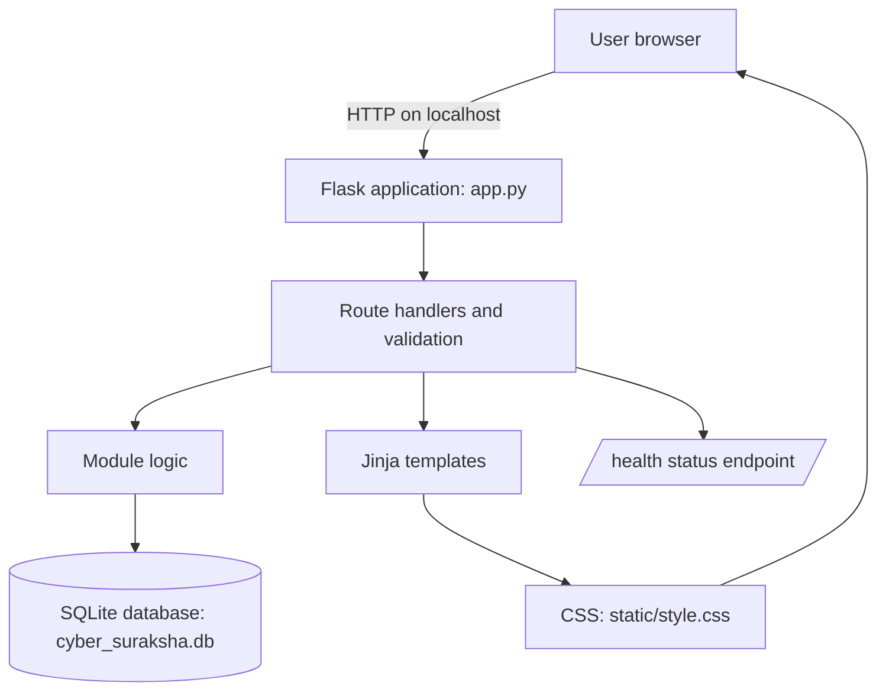

# Architecture

## System context

The application is a single-process Flask web app. A browser sends HTTP requests to Flask routes; route handlers validate form inputs, call local Python logic and read/write a local SQLite database. Jinja templates render HTML and `static/style.css` supplies presentation. There are no external service integrations in the current prototype.

## Application modules and routes

| Route | Purpose |
|---|---|
| `/` | Dashboard and incident summary |
| `/report` | Local cybercrime incident intake |
| `/incidents` | Incident register |
| `/incident/<reference>` | Local incident detail |
| `/fraud-simulator` | Fictional financial-fraud decision simulator |
| `/soc-simulator` | Synthetic SOC alert list and filters |
| `/soc/<alert_id>` | SOC alert investigation and analyst notes |
| `/zero-trust` | Simulated access decision exercise |
| `/disclosure` | Local responsible-disclosure intake for fictional assets |
| `/awareness` | Awareness material and quiz; language selection supports English, Hindi and Telugu |
| `/health` | Basic health response |

## Data model (high level)

The application creates tables additively using SQLite `CREATE TABLE IF NOT EXISTS` statements.

- `incidents`: incident reference, timestamp, incident type/channel/date, amount, contact fields, description, evidence note, status and demo marker.
- `soc_alerts`: synthetic alert identifiers and alert/triage information used by the SOC simulator.
- `zero_trust_evaluations`: records simulated access decisions and reasons.
- `disclosure_reports`: local disclosure report reference, fictional asset, title, severity, details, remediation and timestamp.

For exact column definitions, inspect the table creation statements in `app.py`. The application uses a local database file; do not commit a populated database.

## Request lifecycle

1. The browser requests a page or submits a form.
2. Flask dispatches to the matching route.
3. The route reads form/query values and applies the validation implemented for that feature.
4. The route performs local processing and, where applicable, uses parameterized SQLite statements.
5. Flask renders a Jinja template or returns a JSON response.

## Trust boundaries

- Browser input is untrusted and must be validated server-side.
- The SQLite file is local application data and may contain user-entered information.
- Demo alerts and seeded records are synthetic and must remain clearly labelled as examples.
- No outbound API or external platform integration is implemented in this version.

## Architecture constraints

This is a beginner-friendly monolithic prototype, not a scalable multi-user service. Before deployment, separate configuration from code, introduce authentication/authorization and CSRF protection, use secure session settings and secrets, add audit and retention controls, and perform an independent security review.
