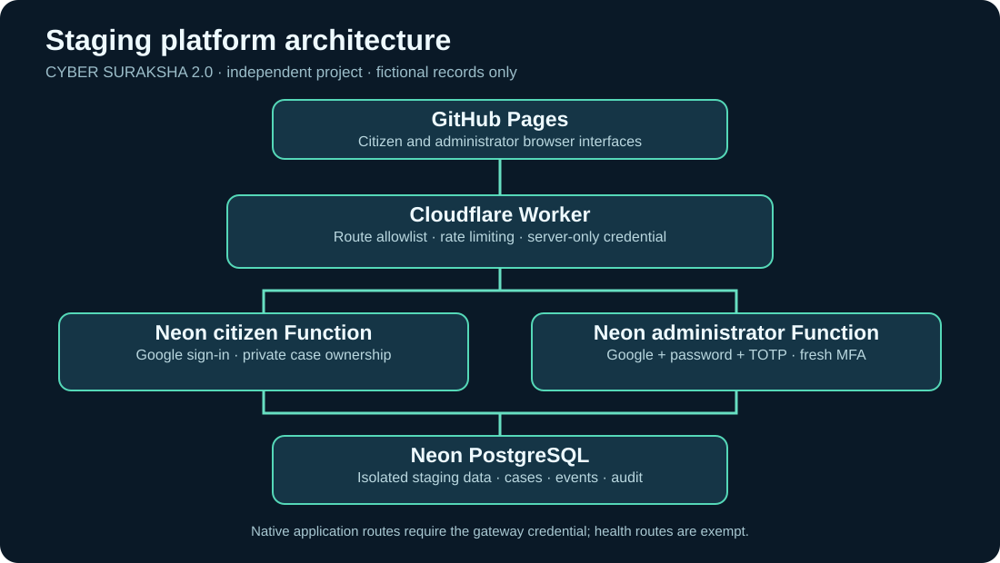
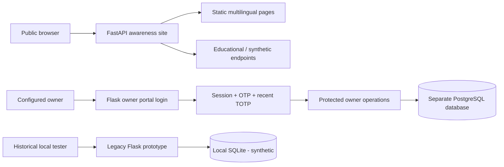

# Architecture and service boundaries

[Documentation center](README.md) · [Technology map](TECHNOLOGY_STACK.md) · [Owner access](OWNER_PORTAL_ACCESS_REVIEW.md)

CYBER SURAKSHA 2.0 holds **two current, independently configured web services** plus historical training and earlier integrated website sources. Do not treat their databases, startup commands, access policies or readiness evidence as interchangeable.

## System context

| Service | Stack | Entrypoint | Primary function |
| --- | --- | --- | --- |
| Public awareness | Python, FastAPI, Uvicorn, HTML/CSS/JS | [main.py](../deploy/cyber-suraksha-independent/main.py) | Multilingual educational content and on-device safety tools |
| Owner pilot | Python, Flask, Gunicorn, SQLAlchemy, PostgreSQL | [app.py](../deploy/citizen-owner-portal/app.py) | Owner-controlled sign-in and protected administration for synthetic acceptance |
| Historical training | Python, Flask, Jinja, SQLite | [app.py](../app.py) | Fictional incident intake, SOC simulations, Zero Trust exercises |

## Trust and data boundaries

The current public site does not register real complaints or send reports to police/banks. The owner pilot should remain private and should not collect actual victim details until explicit independent security, privacy, database and operational approval checks have been completed. The original Flask demo is development/training source, not a unified production dependency.

## Owner authorization pathway

The Flask portal's [request-level private gate](../deploy/citizen-owner-portal/portal/__init__.py) and [owner MFA decorator](../deploy/citizen-owner-portal/portal/security.py) are present in source. The [pilot Blueprint](../deploy/citizen-owner-portal/render-free-pilot.yaml) sets private mode and disables public registration. See [live access review](OWNER_PORTAL_ACCESS_REVIEW.md); repository source alone does not establish deployment behavior.

## Dependencies and integrations

- **Awareness:** FastAPI and Uvicorn, with multilingual static assets.
- **Portal:** Flask, SQLAlchemy/psycopg, PostgreSQL, PyOTP, cryptography, and an HTTPS email API integration.
- **Optional:** URL reputation checks require a separately configured provider key; no always-on live provider guarantee is made.
- **Deployment:** Render blueprints for distinct services. Prior local Nginx/CA work is outside this repository's live release evidence.

## Operational constraints

Web and API inputs are untrusted. Keep secrets in protected hosting settings, enforce permissions on the server, maintain synthetic acceptance records, apply rate and origin checks, and verify durability, backups, retention, monitoring and an independent security assessment before real data intake.

**Historical note:** The monolithic Flask/SQLite architecture discussed in older source documents describes the preserved training app only. The repository's current service inventory is shown above.
