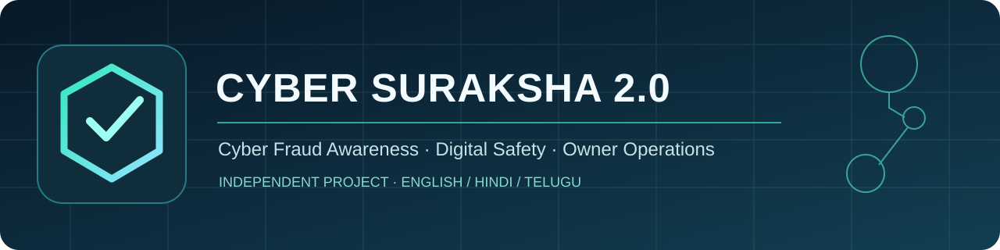
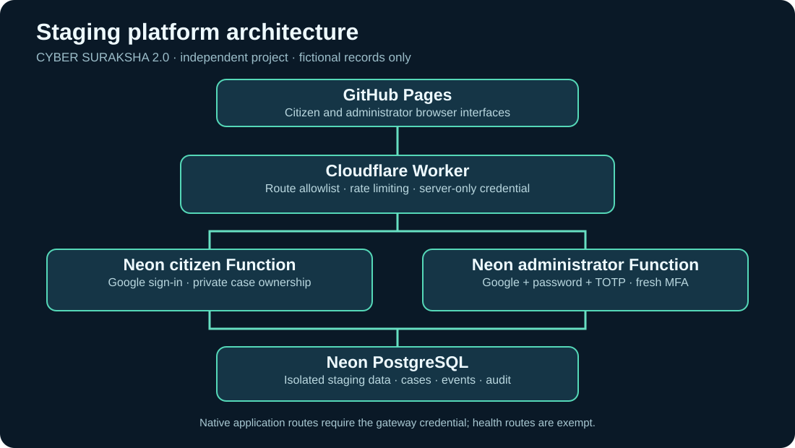

# Project overview

**CYBER SURAKSHA 2.0 — From Cyber Fraud Awareness to Intelligent Cybercrime Prevention & Response**

An independently maintained cybersecurity education initiative focused on helping people recognise scams, learn safe response steps and practice with synthetic security scenarios.

## Product areas

| Area | Purpose | Source |
| --- | --- | --- |
| Multilingual awareness | English, Hindi and Telugu guidance | [FastAPI service](../deploy/cyber-suraksha-independent/) |
| Scam-signal checking | On-device rule-based educational signals, not a guarantee | [JavaScript checker](../deploy/cyber-suraksha-independent/site/app.js) |
| Action planning | Practical general response steps; no direct bank/police submission | [Public pages](../deploy/cyber-suraksha-independent/site/) |
| Training | Simulated SOC alerts and fictional incidents | [Legacy Flask source](../app.py) |
| Owner portal | Controlled owner administration and private pilot workflows | [Owner portal](../deploy/citizen-owner-portal/) |

## Code and deployment overview

See [Technology stack](TECHNOLOGY_STACK.md), [Architecture](ARCHITECTURE.md), [Testing](TESTING.md), and [Release readiness](RELEASE_READINESS.md) for implementation and verification details.

## Illustrative cybersecurity infrastructure

*Photograph: Carl Lender, [Wikimedia Commons](https://commons.wikimedia.org/wiki/File:Datacenter_Server_Racks_(22370909788).jpg), [CC BY 2.0](https://creativecommons.org/licenses/by/2.0/). Illustration only — not project-owned infrastructure or its hosting environment.*

## Public safety and scope

CYBER SURAKSHA 2.0 is not a government, police, bank or CERT-In service and does not file official complaints. The standalone awareness site is public educational content; the separate pilot is configured for owner-only testing. Do not submit real victim information or private security material to the unverified pilot.

For a real Indian cybercrime complaint, use [the National Cyber Crime Reporting Portal](https://cybercrime.gov.in/) and, for urgent financial cyber fraud, call **1930**.

## Identity and rights

Project maintained independently by the GitHub repository owner. The software, documentation, referenced third-party media and historical components have distinct rights and licenses; see [LICENSE](../LICENSE), [Media credits](VISUAL_ASSETS.md) and [Copyright preparation](COPYRIGHT_REGISTRATION_PREPARATION.md).

[Back to documentation](README.md)
