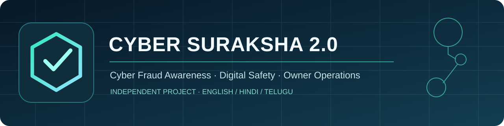

# CYBER SURAKSHA 2.0 — Documentation Center

**Purpose:** the authoritative map of current guides, deployment boundaries and preserved historical project records. This index does not assert that every service is live or audited.

## Start here

| Topic | Document |
| --- | --- |
| Project summary | [Project overview](PROJECT_OVERVIEW.md) |
| Software languages and dependencies | [Technology stack](TECHNOLOGY_STACK.md) |
| Services and trust boundaries | [Architecture](ARCHITECTURE.md) |
| Engineering decisions | [Technical design](TECHNICAL_DESIGN.md) |
| Run and deploy the awareness service | [Rebuild/deployment](REBUILD_DEPLOYMENT.md) |
| Verify private owner access | [Owner access review](OWNER_PORTAL_ACCESS_REVIEW.md) |
| Tests and evidence | [Testing](TESTING.md) |
| Release prerequisites | [Release readiness](RELEASE_READINESS.md) |
| Copyright evidence | [Copyright preparation](COPYRIGHT_REGISTRATION_PREPARATION.md) |
| Photos, diagrams and license credits | [Media credits](VISUAL_ASSETS.md) |

## Application-specific guides

- **Public awareness website:** [README — independent preview](../deploy/cyber-suraksha-independent/README_STAGE19.md), [privacy](../deploy/cyber-suraksha-independent/PRIVACY.md), [security](../deploy/cyber-suraksha-independent/SECURITY.md), [release limits](../deploy/cyber-suraksha-independent/SECURITY_LIMITATIONS_RELEASE.md).
- **Owner-only pilot:** [Portal README](../deploy/citizen-owner-portal/README.md), [free pilot guide](../deploy/citizen-owner-portal/README_FREE_OWNER_PILOT.md), [portal security](../deploy/citizen-owner-portal/SECURITY.md), [optional reputation evidence](../deploy/citizen-owner-portal/docs/REPUTATION.md).
- **Original Flask training app:** [Project documentation](../PROJECT_DOCUMENTATION.md), [historical design reference](LEGACY_FLASK_README.md), [manual tests](../MANUAL_TEST_CHECKLIST.md).

## Project governance

[Repository README](../README.md) · [Security](../SECURITY.md) · [Accessibility](../ACCESSIBILITY.md) · [Contributing](../CONTRIBUTING.md) · [Code of conduct](../CODE_OF_CONDUCT.md) · [Safe sample data](../SAFE_SAMPLE_DATA.md) · [MIT license](../LICENSE)

## Historical and archival records

The following materials are retained for traceability. They may include time-specific release plans, earlier names, old deployment URLs and test results for earlier code versions. **Do not treat those records as current hosting instructions, external approval or recent test evidence.**

- [Original Flask architecture and source notes](LEGACY_FLASK_README.md).
- [Historical GitHub archive snapshot](archived-original-github/README.md) and accompanying preserved PR/issue JSON.
- [Earlier unified website](../upgrades/unified-website/README.md), including its [historical evaluation and security plans](../upgrades/unified-website/docs/).
- [Portal R3 release package record](../deploy/citizen-owner-portal/README_DEPLOYMENT.md).
- [Stage 19 release preparation](../deploy/cyber-suraksha-independent/README_STAGE19.md) and [unified preview notes](../deploy/cyber-suraksha-independent/UNIFIED_RELEASE.md).
- Numerical test results, JSON integrity manifests and original license files are retained as generated evidence and are not rewritten to match current presentation styling.

## Editorial standards

The active docs identify the exact application they describe, link to real repository source paths and avoid unsupported assurances. Illustrative images are credited. Legal authorship declarations must be verified; project independence does not imply certification or government affiliation. Never publish live credentials, case records, or private database contents.
