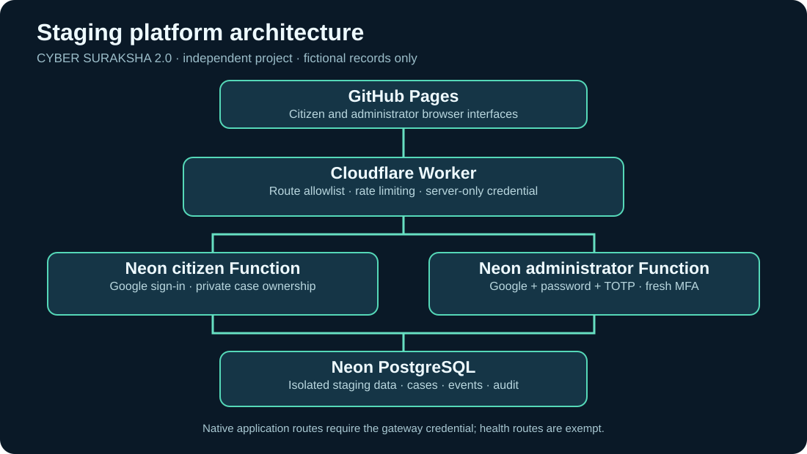

# Technology stack and code map

[Documentation index](README.md) · [Architecture](ARCHITECTURE.md) · [Repository home](../README.md)

The languages below describe **files actually present in the repository**. They are not certification claims, performance benchmarks or evidence that every prototype runs in production.

| Language / technology | Usage | Reference files |
| --- | --- | --- |
| **Python** | Server-side web application and tests | [FastAPI service](../deploy/cyber-suraksha-independent/main.py), [Flask portal routes](../deploy/citizen-owner-portal/portal/routes.py), [original learning app](../app.py) |
| **HTML / Jinja** | Multilingual pages and Flask-rendered screens | [Public English page](../deploy/cyber-suraksha-independent/site/en/index.html), [portal templates](../deploy/citizen-owner-portal/templates/) |
| **CSS** | Responsive application styling | [Public CSS](../deploy/cyber-suraksha-independent/site/app.css), [portal CSS](../deploy/citizen-owner-portal/static/css/site.css) |
| **JavaScript** | On-device checking, interactions and tests | [Public JS](../deploy/cyber-suraksha-independent/site/app.js), [scam checker](../deploy/citizen-owner-portal/static/js/scam_checker.js) |
| **SQL / SQLite** | Historical Flask training database and local synthetic examples | [Original Flask source](../app.py), [sample data policy](../SAFE_SAMPLE_DATA.md) |
| **PostgreSQL / SQLAlchemy** | Owner portal database models and controlled records | [Models](../deploy/citizen-owner-portal/portal/models.py), [portal package](../deploy/citizen-owner-portal/portal/) |
| **PowerShell / Windows batch** | Local starts and release workflows | [Awareness launcher](../START_R4_WINDOWS.bat), [historical launcher](../run_windows.bat) |
| **YAML** | Deployment and GitHub Actions configuration | [Awareness Render config](../render.yaml), [owner pilot config](../deploy/citizen-owner-portal/render-free-pilot.yaml), [CI workflow](../.github/workflows/tests.yml) |
| **Markdown / JSON** | Project records, documentation and content data | [Documentation index](README.md), [public UI data](../deploy/citizen-owner-portal/data/ui_en.json) |

## Frameworks and services

| Component | Dependency / purpose | Actual scope |
| --- | --- | --- |
| FastAPI, Uvicorn | Public awareness web backend | Independent public service |
| Flask, Gunicorn | Authenticated owner portal | Separate controlled pilot |
| SQLAlchemy, psycopg | PostgreSQL-oriented portal persistence | Owner portal |
| cryptography, PyOTP | TOTP secret handling and MFA support | Owner portal |
| Resend | HTTPS email API for verification / manual notification | Requires private configuration and real delivery verification |
| Optional Google Safe Browsing v5 | Listed-threat reputation evidence | Disabled without a configured provider key |
| Render | Hosting configuration | Actual deployment must be verified separately |
| GitHub Actions | Automated source tests | Results tied to each specific run |

For exact dependency versions inspect [owner portal requirements](../deploy/citizen-owner-portal/requirements.txt), [public site requirements](../deploy/cyber-suraksha-independent/requirements.txt) and the [legacy requirements](../requirements.txt).

## Logical service boundary

The private portal and public awareness site share branding and some material but are **not the same application or authentication domain**. Use [owner access requirements](OWNER_PORTAL_ACCESS_REVIEW.md) for protected routes. Historical scripts and old user guides are maintained as evidence, not current deployment instructions.
